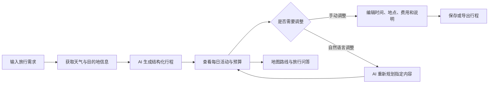

# GoTrip — AI 个性化旅行规划产品

> 让 AI 生成的不只是“看起来不错”的旅游攻略，而是一份可以编辑、调整、导航和管理预算的可执行行程。

[在线体验](https://xingfei686-dot.github.io/DEMO/) · [查看核心产品代码](./app/page.tsx)


## 项目概览

GoTrip 是一款面向自由行用户的 AI 旅行规划产品。用户输入目的地、日期、同行人数、预算和旅行节奏后，系统会结合天气与目的地信息，生成按天拆分的结构化行程；用户可以继续编辑具体活动，或通过自然语言让 AI 调整整份计划。

这个项目重点探索一个 AI 产品问题：

**如何把大模型输出从一段“旅游建议”，转化为用户真正可以执行和持续修改的旅行方案？**

- **项目类型：**个人项目 / 可交互产品原型
- **我的职责：**产品定义、需求分析、交互设计、AI 方案设计、前端实现与上线
- **当前状态：**核心链路已完成，可通过 GitHub Pages 在线体验
- **产品边界：**当前为演示版本，行程保存在本地设备，不产生真实订单或付款

## 项目背景

旅行规划通常需要用户在攻略平台、天气应用、地图和预算工具之间来回切换。通用大模型虽然能够快速生成建议，但结果经常存在三个问题：

1. 输出以长文本为主，难以直接修改和执行；
2. 缺少实时天气、地点和路线等外部信息；
3. 用户提出局部调整后，模型容易重新生成全部内容，导致原有安排丢失。

因此，GoTrip 没有把“聊天”作为最终交付形态，而是将 AI 作为行程规划引擎，让生成结果进入可编辑的产品界面。

## 目标用户

主要面向希望自主规划、但不愿投入大量时间整理攻略的自由行用户：

- 第一次前往陌生目的地，需要快速建立行程框架；
- 有明确预算、日期或旅行节奏，希望获得个性化方案；
- 已有初步计划，希望通过一句话完成局部调整；
- 需要把景点、路线和费用放在同一处管理。

## 用户痛点与产品方案

| 用户痛点 | GoTrip 的产品方案 |
| --- | --- |
| 攻略信息分散，规划路径长 | 将需求输入、行程生成、天气、路线和预算整合到同一流程 |
| AI 输出是大段文本，难以使用 | 将结果约束为“天—活动—时间—地点—费用”的结构化数据 |
| 个性化条件难以同时满足 | 将日期、人数、预算和旅行节奏作为规划上下文 |
| 修改一个安排需要重新规划 | 支持自然语言二次调整，并要求 AI 保留未被修改的内容 |
| 行程生成后仍需到地图中重新搜索 | 为单个地点和每日行程提供地图导航入口 |
| 不清楚整体花费是否超出预算 | 展示住宿、交通、活动费用与总预算的拆分和对比 |

## 核心使用流程



## 核心功能

### 1. 个性化行程生成

用户可以设置目的地、出行日期、同行人数、总预算和旅行节奏。系统将这些条件与外部旅行信息一并传给 AI，生成最多 7 天、每天最多 6 个活动的结构化方案。

每项活动包含：

- 建议时间；
- 活动名称与说明；
- 对应地点；
- 预估费用。

### 2. 用一句话调整整份行程

用户可以输入：

- “第二天轻松一点”
- “预算控制在 5000 元以内”
- “下雨天换成室内活动”

AI 会根据当前行程和新增要求重新规划，同时保留用户没有要求修改的内容。相比一次性生成，这一设计更接近真实的旅行规划过程。

### 3. 实时信息增强

- 通过 Open-Meteo 获取旅行日期内的天气预报；
- 通过 Wikipedia 检索目的地和景点信息；
- 在界面中展示联网依据与更新时间，帮助用户判断信息时效性；
- 支持 Google Maps、Apple Maps 和高德地图路线跳转。

### 4. 可编辑的结构化行程

用户可以直接修改活动时间、名称、地点、说明与费用，也可以新增或删除活动。AI 负责提供初稿，用户保留最终决定权。

### 5. 预算、收藏与导出

- 汇总住宿、交通与活动费用；
- 对比预估总额和用户预算；
- 将行程保存在当前设备；
- 支持收藏、导出和模拟下单流程；
- 内置旅行问答助手，回答当前目的地的景点、美食和交通问题。

## AI 产品方案

### 输入层

将开放式旅行需求拆分为目的地、日期、人数、预算和节奏等明确变量，减少模型理解歧义，同时保留自然语言补充空间。

### 上下文层

生成前获取天气与目的地信息，并将当前行程作为二次调整的上下文，使模型能够基于实时条件和已有方案继续工作。

### 生成层

要求模型返回约定的 JSON 数据结构，而不是直接输出 Markdown 攻略。前端对返回内容进行解析、字段规范化和数量限制，再渲染为可编辑行程。

### 交互层

同时提供两种修改方式：

- **直接编辑：**适合用户修改确定的时间、地点和费用；
- **自然语言调整：**适合表达“更轻松”“减少预算”等模糊目标。

这种设计让用户不必为了一个小修改反复重写完整提示词。

### 兜底与风险控制

- 对模型返回内容进行结构校验和默认值补全；
- 限制生成天数和每天活动数量，避免信息过载；
- 清晰标注价格仅供规划参考；
- 外部服务不可用时提供错误反馈，不把失败结果当作有效行程；
- 当前版本不执行真实预订和付款，避免演示流程造成误解。

## 关键产品取舍

### 为什么不只做一个聊天机器人？

旅行计划最终需要被查看、比较、编辑和执行。纯聊天记录不适合管理多天、多地点和多项费用，因此 GoTrip 将对话作为输入方式，将结构化行程作为最终载体。

### 为什么保留手动编辑？

AI 无法完全掌握用户的临时偏好、体力和现场变化。直接编辑能降低修改成本，也能避免用户被迫接受模型给出的结果。

### 为什么同时支持 AI 调整和手动调整？

两种方式对应不同任务：明确的小改动使用表单更高效；模糊或涉及全局约束的改动更适合交给 AI 重新规划。

### 为什么当前使用本地存储？

对于个人原型，本地存储可以快速验证核心规划链路，同时减少账号体系和后端开发对验证重点的干扰。代价是暂不支持跨设备同步，这也是后续版本的重要方向。

## 项目验证

当前版本已经完成核心功能与可交互 Demo，但**尚未进行大规模用户测试**，因此项目不使用未经验证的“效率提升”或“满意度提升”数据。

下一步计划邀请 5–10 位有自由行经历的用户完成任务测试，重点记录：

| 验证问题 | 计划指标 |
| --- | --- |
| 用户能否独立完成一次旅行规划 | 核心任务完成率 |
| AI 生成结果是否可以直接采用 | 行程活动保留率 |
| 用户是否能理解并使用二次调整 | 二次调整成功率 |
| 相比手动整理攻略是否更省时 | 首份可用行程生成时长 |
| 天气、预算和地图信息是否有帮助 | 功能使用率与访谈反馈 |
| 模型结果是否稳定 | 结构化输出成功率、异常类型 |

测试后将根据真实结果更新本节，并优先修复影响核心任务完成的问题。

## 版本规划

### 已完成

- [x] 结构化旅行需求输入
- [x] AI 个性化行程生成
- [x] 自然语言二次调整
- [x] 实时天气与目的地信息
- [x] 行程卡片增删改
- [x] 多地图路线跳转
- [x] 预算拆分与编辑
- [x] 本地收藏与行程导出
- [x] 旅行问答与模拟下单

### 下一步

- [ ] 开展首轮可用性测试并形成测试报告
- [ ] 建立 AI 行程质量评估集，覆盖预算、时间、路线和天气约束
- [ ] 增加生成前需求澄清，减少信息不足时的错误假设
- [ ] 支持多方案对比与冲突提示
- [ ] 增加账号体系和跨设备同步
- [ ] 接入真实交通、酒店和景点价格数据
- [ ] 补充移动端适配测试与无障碍体验

## 技术实现

- **应用框架：**Next.js、React、TypeScript
- **界面实现：**Tailwind CSS、shadcn/ui、Lucide Icons
- **AI 能力：**豆包大模型
- **外部信息：**Open-Meteo、Wikipedia
- **地图能力：**Google Maps、Apple Maps、高德地图
- **数据存储：**浏览器 Local Storage
- **部署方式：**GitHub Pages / Cloudflare Worker

## 本地运行

建议使用 Node.js 22.13 或更高版本。

```bash
npm install
npm run dev
```

启动后按照终端输出的地址在浏览器中访问项目。

## 项目说明

- Demo 中的费用为规划参考，不代表实时价格；
- “模拟下单”不会产生真实订单或付款；
- 行程数据默认保存在当前浏览器；
- 天气、百科和地图能力依赖第三方服务的可用性；
- AI 生成内容可能存在偏差，重要信息请在出行前再次确认。

---

如果你正在以招聘方或面试官的身份查看本项目，建议先体验以下链路：

1. 输入目的地、日期、人数、预算与旅行节奏；
2. 生成一份 AI 行程；
3. 使用一句话调整第二天安排或整体预算；
4. 手动编辑某项活动并查看路线；
5. 查看费用拆分并导出结果。
