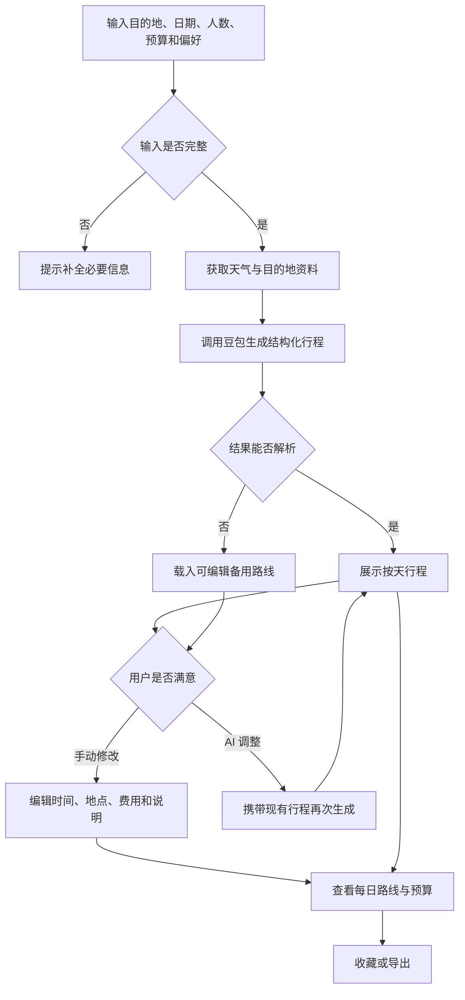

# GoTrip 产品需求文档（PRD）

> AI 个性化旅行规划产品：将大模型生成的旅行建议转化为可编辑、可导航、可管理预算的执行型行程。

- **文档版本：**V1.1
- **更新日期：**2026-10-13
- **产品状态：**MVP 已上线
- **项目角色：**个人项目，独立完成产品定义、需求分析、AI 方案、交互设计、前端开发与部署
- **在线体验：**[GoTrip Demo](https://xingfei686-dot.github.io/DEMO/?v=20261013-amap)
- **项目仓库：**[xingfei686-dot/DEMO](https://github.com/xingfei686-dot/DEMO)

---

## 1. 产品概述

### 1.1 产品定位

GoTrip 是一款面向自由行用户的 AI 旅行规划工具。用户输入目的地、日期、同行人数、预算、旅行节奏和个性化偏好后，系统结合天气与目的地信息，生成按天拆分的结构化行程。

与直接输出长文本攻略不同，GoTrip 将 AI 结果转化为可继续编辑的产品界面。用户既可以修改具体时间、地点、费用与说明，也可以通过自然语言让 AI 调整整份方案。

### 1.2 核心命题

**如何将大模型的一次性回答，转化为用户可以理解、修改、执行和持续迭代的旅行方案？**

### 1.3 产品价值

- 降低从零开始整理旅行攻略的时间成本；
- 将天气、地点、路线和预算集中在同一流程；
- 将 AI 输出约束为可操作的结构化行程；
- 支持“AI 生成 + 用户编辑”的人机协作；
- 在模型或外部服务失败时，仍向用户提供可继续编辑的结果。

---

## 2. 项目背景与问题定义

自由行用户通常需要在攻略平台、天气应用、地图和预算工具之间反复切换。即使使用通用大模型，仍可能遇到以下问题：

| 问题 | 用户影响 |
| --- | --- |
| 信息分散在多个平台 | 需要反复检索、复制和整理 |
| AI 输出以长文本为主 | 不便按天查看，也难以局部修改 |
| 地点、费用与路线缺少约束 | 方案看似合理，但不一定能执行 |
| 外部信息缺乏时效性 | 天气变化后原方案可能失效 |
| 局部修改导致整份方案重写 | 用户已有选择容易丢失 |
| 模型和第三方接口存在不稳定性 | 生成中断后用户无法继续操作 |

GoTrip 的产品思路不是继续增加一层聊天界面，而是让 AI 负责生成和调整，将结构化行程作为用户最终使用的载体。

---

## 3. 产品目标与非目标

### 3.1 MVP 目标

1. 用户可以在一次流程中完成旅行需求输入和首份行程生成；
2. AI 输出可以被稳定解析为按天组织的活动卡片；
3. 用户可以手动编辑行程，也可以通过自然语言进行整体调整；
4. 行程能够关联天气、地点信息、每日路线和预算；
5. 大模型或外部服务失败时，用户仍能获得可编辑的备用方案；
6. 用户可以在当前设备保存并导出行程。

### 3.2 当前非目标

MVP 阶段暂不实现：

- 真实机票、酒店和景点库存查询；
- 实时价格与预订交易；
- 支付、退款及订单履约；
- 自动计算全局最优交通路线；
- 多人实时协作；
- 云端账号体系与跨设备同步；
- 对 AI 内容准确性的完全保证。

---

## 4. 目标用户

### 4.1 核心用户

希望自主规划旅行，但不愿投入大量时间整理攻略的自由行用户。

### 4.2 用户特征

- 第一次前往陌生目的地；
- 已确定日期和大致预算；
- 对旅行节奏或主题有个人偏好；
- 希望快速获得初稿，再根据实际需求修改；
- 需要统一查看行程、路线和费用。

### 4.3 典型用户画像

**用户A：城市短途旅行者**

- 2–4 天城市旅行；
- 希望快速覆盖主要景点；
- 关注路线是否顺路及每日费用；
- 生成后通常只需调整少量安排。

**用户B：偏好明确的深度旅行者**

- 对建筑、美食、艺术或自然有明确兴趣；
- 不接受通用“打卡式”攻略；
- 需要多轮调整旅行节奏和活动内容。

**用户C：多人或家庭旅行者**

- 需要考虑同行人数、老人或儿童；
- 对预算、体力和天气更敏感；
- 需要减少不现实的跨区移动。

---

## 5. 核心需求与用户故事

| 编号 | 用户故事 | 优先级 |
| --- | --- | --- |
| US-01 | 作为旅行者，我希望输入日期、预算和偏好后快速获得行程初稿 | P0 |
| US-02 | 作为旅行者，我希望行程按天、时间和地点展示，便于理解和执行 | P0 |
| US-03 | 作为旅行者，我希望直接修改某个活动，而不必重新生成全部内容 | P0 |
| US-04 | 作为旅行者，我希望用一句话调整行程节奏、预算或天气安排 | P0 |
| US-05 | 作为旅行者，我希望查看每天的地点顺序并跳转地图导航 | P0 |
| US-06 | 作为旅行者，我希望知道当前预估花费是否超过预算 | P0 |
| US-07 | 作为旅行者，我希望查看地点图片和基础信息，辅助判断是否保留 | P1 |
| US-08 | 作为旅行者，我希望保存或导出方案，之后继续查看 | P1 |
| US-09 | 作为旅行者，我希望询问当前目的地的景点、美食和交通问题 | P1 |
| US-10 | 作为旅行者，当 AI 暂时不可用时，我仍希望继续编辑备用方案 | P0 |

---

## 6. 核心使用流程



---

## 7. 功能需求

### 7.1 FR-01 旅行需求输入

**优先级：P0**

用户可以输入或选择：

- 目的地；
- 开始与结束日期；
- 同行人数；
- 总预算；
- 旅行节奏：松弛慢游、张弛有度、充实探索；
- 自然语言偏好。

**校验规则：**

- 目的地不能为空；
- 结束日期不得早于开始日期；
- 预算必须大于 0；
- 单次最多生成 7 天行程；
- 缺少必要信息时不得发起生成请求。

### 7.2 FR-02 AI 行程生成

**优先级：P0**

系统将结构化需求、天气和目的地资料传入豆包大模型，要求返回 JSON 行程。

每一天包含：

- 日期序号；
- 当天主题；
- 2–4 个活动。

每个活动包含：

- 建议时间；
- 活动名称；
- 可地图检索的具体地点；
- 推荐理由、交通或预约提醒；
- 预估费用。

### 7.3 FR-03 行程展示与手动编辑

**优先级：P0**

用户可以：

- 按天切换行程；
- 修改活动时间；
- 修改活动名称和具体地点；
- 修改活动说明和预估费用；
- 新增或删除活动；
- 查看每天活动数和费用合计。

AI 只负责提供初稿，用户保留最终决定权。

### 7.4 FR-04 自然语言调整

**优先级：P0**

用户可以通过自然语言修改现有行程，例如：

- “第二天轻松一点”；
- “预算控制在 5000 元以内”；
- “下雨天换成室内活动”；
- “增加建筑和设计相关地点”。

调整请求需要携带当前完整行程作为上下文，并要求模型保留未被用户要求修改的安排。

### 7.5 FR-05 实时信息增强

**优先级：P0**

- 使用 Open-Meteo 获取旅行日期内的天气数据；
- 使用 Wikipedia 获取目的地候选资料；
- 展示数据来源和更新时间；
- 天气或地点资料获取失败时，不阻塞 AI 行程生成。

### 7.6 FR-06 地点详情与地图

**优先级：P0**

- 根据城市和地点获取参考图片；
- 支持编辑具体地点；
- 支持单地点跳转 Google Maps、Apple Maps 和高德地图；
- 根据当天活动顺序生成每日多点路线入口；
- 当前仅提供路线跳转，不承诺计算全局最优路线。

### 7.7 FR-07 预算管理

**优先级：P0**

系统展示：

- 住宿费用；
- 交通费用；
- 活动与餐饮费用；
- 行程预估总额；
- 用户总预算；
- 预算剩余或超支状态。

当前费用为规划参考，不代表实时交易价格。

### 7.8 FR-08 收藏、草稿与导出

**优先级：P1**

- 自动保存当前草稿；
- 用户可以收藏或取消收藏行程；
- 行程保存在浏览器 Local Storage；
- 支持将行程导出为文本文件；
- 刷新页面后可以恢复本地数据。

### 7.9 FR-09 旅行问答助手

**优先级：P1**

助手携带当前目的地、日期、人数、预算和已生成行程作为上下文，回答景点、美食、交通和当前计划相关问题。

当豆包不可用时：

1. 优先根据页面现有预算、日期和行程回答；
2. 尝试查询公开目的地资料；
3. 查询仍失败时，明确告知用户当前限制。

### 7.10 FR-10 模拟下单

**优先级：P2**

模拟展示行程确认和提交过程，用于验证产品流程，不创建真实订单，也不产生付款。

---

## 8. 信息架构

```text
GoTrip
├── 首页
│   ├── 产品价值说明
│   ├── 创建行程
│   └── 推荐目的地
├── 行程规划器
│   ├── 行程概览
│   ├── AI 行程调整
│   ├── 每日活动编辑
│   ├── 地点详情
│   ├── 每日路线
│   └── 预算拆分
├── 我的行程
│   ├── 草稿
│   ├── 收藏
│   └── 导出
└── GoTrip 助手
    ├── 目的地问答
    ├── 当前行程问答
    └── 降级回答
```

---

## 9. AI 产品方案

### 9.1 模型输入

模型上下文包含：

```json
{
  "city": "东京",
  "dates": "2026-10-20 至 2026-10-23",
  "travelers": 2,
  "budget": 8000,
  "style": "张弛有度",
  "preference": "喜欢建筑和美食",
  "weather": "按日期组织的天气信息",
  "places": ["候选地点1", "候选地点2"]
}
```

二次调整时额外加入当前行程。

### 9.2 输出结构

```json
{
  "summary": "本次规划或调整说明",
  "days": [
    {
      "day": 1,
      "title": "当天主题",
      "activities": [
        {
          "time": "09:00",
          "title": "活动名称",
          "place": "可检索的具体地点",
          "detail": "推荐理由、交通或预约提醒",
          "cost": 120
        }
      ]
    }
  ]
}
```

### 9.3 输出规范化

前端对模型结果执行：

- 提取 JSON 主体；
- 校验 days 是否为非空数组；
- 限制最多 7 天；
- 限制每天最多 6 个活动；
- 无效时间回退为默认时间；
- 缺失标题、说明、地点时补充默认值；
- 将费用转换为非负数字；
- 解析失败时进入备用路线。

### 9.4 降级策略

| 异常 | 产品处理 |
| --- | --- |
| 地理编码失败 | 继续使用用户输入的城市 |
| 天气接口失败 | 标记天气暂不可用，但继续生成 |
| 地点资料失败 | 不提供候选地点，但继续生成 |
| AI 请求超时或失败 | 加载可编辑备用路线 |
| AI 输出无法解析 | 提示失败并使用备用内容 |
| 地点图片失败 | 展示目的地参考图 |
| 旅行问答模型失败 | 使用页面数据或公开资料回答 |
| 地图服务不可用 | 保留地点文本和手动编辑能力 |

### 9.5 AI 风险

- 地点可能不存在或同名异地；
- 费用不代表实时价格；
- 路线可能存在折返；
- 模型可能忽略预算、天气或特殊人群约束；
- 外部数据可能过期或不可用；
- 自然语言调整可能误改用户希望保留的内容。

因此，产品需要同时提供来源提示、手动编辑、地图核验和异常反馈。

---

## 10. 产品状态与验收标准

### 10.1 MVP 验收标准

- [x] 可以输入完整旅行需求；
- [x] 可以生成按天组织的结构化行程；
- [x] 可以编辑、新增和删除活动；
- [x] 可以通过自然语言调整已有行程；
- [x] 可以查看天气来源和地点信息；
- [x] 可以跳转单地点及每日路线；
- [x] 可以编辑并查看预算拆分；
- [x] 可以收藏、恢复和导出行程；
- [x] AI 不可用时提供可编辑备用路线；
- [x] 已完成线上部署，可公开访问。

### 10.2 当前限制

- 尚未完成正式的大规模用户测试；
- 尚未接入真实价格、库存和交易；
- 地点真实性仍依赖模型输出与用户核验；
- 当前数据保存在本地浏览器；
- 预算拆分主要用于规划参考；
- 已完成首轮 30 条离线评测；尚未完成正式用户可用性测试与线上 A/B 实验。

---

## 11. AI 模型评测与迭代

### 11.1 评测集设计

建立 30 条固定旅行规划测试用例，按照 **20 条开发集 + 10 条隐藏集** 划分，覆盖五类场景：

| 场景 | 用例数 | 重点验证问题 |
| --- | ---: | --- |
| 基础规划 | 6 | 常规多日行程的完整性与可执行性 |
| 预算约束 | 6 | 低预算、多人费用与币种口径 |
| 天气约束 | 6 | 降雨、大风、高温及天气未知 |
| 特殊需求 | 6 | 老人、亲子、无障碍、晚到早走 |
| 边界场景 | 6 | 冷门城市、长行程、紧预算及信息不足 |

### 11.2 评测维度与规则

| 维度 | 判断标准 | 评测方式 |
| --- | --- | --- |
| 结构完整性 | JSON 可解析、天数正确、日期连续、字段齐全、每天 2–4 个活动 | 脚本确定性校验 |
| 预算符合度 | 所有活动费用为同行人合计人民币，且不超过活动预算 | 脚本确定性校验 |
| 地点真实性 | 地点真实、可检索且属于目标城市，无明显地点幻觉 | 统一 Rubric 辅助评审 |
| 路线合理性 | 同日地点相对集中，避免明显折返与不必要跨区 | 统一 Rubric 辅助评审 |
| 天气适配度 | 逐日匹配天气；恶劣天气优先室内；天气未知时提供提醒或备选 | 统一 Rubric 辅助评审 |

每个维度按 0–2 分评分。可用行程要求结构维度满分、总分不低于 8/10，且任一维度不得为 0。隐藏集在辅助评审后进行人工复核。

### 11.3 V1 与 V3 对照结果

| 指标 | V1 基线 | V3 优化 | 变化 |
| --- | ---: | ---: | ---: |
| JSON 解析成功率 | 83.3% | 96.7% | +13.4pp |
| 结构化输出成功率 | 73.3% | 93.3% | +20.0pp |
| 预算符合率 | 66.7% | 73.3% | +6.6pp |
| 全量可用行程率（辅助评审） | 53.3% | 56.7% | +3.4pp |
| 隐藏集可用行程率（保守复核） | 50.0% | 70.0% | +20.0pp |

完整证据：

- [评测方法与结论](../evals/EVALUATION_REPORT.md)
- [30 条测试用例](../evals/cases.json)
- [逐条评分及汇总](../evals/evaluation-summary-v3.json)
- [基线评测脚本](../evals/run-evaluation.mjs)
- [优化版本评测脚本](../evals/run-v3.mjs)

### 11.4 Bad Case 与迭代

| Bad Case | 原因判断 | 迭代动作 | 当前状态 |
| --- | --- | --- | --- |
| JSON 截断、引号错误 | 输出过长、结构约束不足 | 限制字段长度、要求紧凑 JSON、生成前自检 | 解析成功率明显提升 |
| 预算超支 | 币种、人数和预算口径不统一 | 统一人民币与同行人合计口径，预算紧张时优先免费地点 | 有改善，仍需后置校验 |
| 地点幻觉 | 模型依赖参数知识生成地点 | 优先使用候选地点、禁止编造地点和开放时间 | 尚未彻底解决 |
| 路线绕行 | 仅靠语言模型判断空间关系 | 要求同日区域聚类并预留交通时间 | 效果不稳定 |
| 天气约束遗漏 | 天气未成为逐日硬约束 | 写入逐日天气，恶劣天气优先室内并提供备选 | 小幅改善 |
| 抵离时间冲突 | 用户硬约束缺少程序校验 | 纳入 Bad Case，规划增加结构化约束表与后置校验 | 待实现 |

### 11.5 产品结论

Prompt 优化显著改善了 JSON 解析和结构稳定性，也提升了预算符合率；但地点真实性和路线合理性没有同步提升。因此，Prompt 更适合处理表达与格式问题，地点事实、空间距离和抵离时间等硬约束需要通过外部数据和确定性程序校验。

下一轮计划：

1. 使用 JSON Schema 校验模型返回结构；
2. 增加预算、天数、活动数和抵离时间的后置校验；
3. 接入高德 POI 搜索与路径规划，验证地点存在性、城市归属和真实通勤时间；
4. 校验失败时只重写失败日期，而不是重新生成整份行程；
5. 每条用例重复运行 3 次，记录均值与波动。

> 数据边界：本轮每个版本、每条用例仅生成一次；地点与路线尚未通过地图 API 做全量事实校验，因此结果用于验证迭代方向，不代表线上稳定性结论。

---

## 12. 建议埋点

后续接入服务端数据能力后，建议记录：

| 事件 | 用途 |
| --- | --- |
| planner_view | 进入规划模块 |
| generate_click | 发起行程生成 |
| generate_success | 生成并解析成功 |
| generate_fallback | 进入备用路线 |
| activity_edit | 用户修改活动 |
| activity_delete | 用户删除活动 |
| ai_revision_submit | 发起自然语言调整 |
| ai_revision_success | AI 调整成功 |
| map_open | 打开地图路线 |
| trip_save | 收藏或保存行程 |
| trip_export | 导出行程 |
| assistant_question | 使用旅行问答 |

建议重点关注：

- 生成成功率；
- 生成后编辑率；
- AI 二次调整使用率；
- 地图打开率；
- 收藏或导出率。

---

## 13. 隐私与产品边界

- 当前不要求用户提供身份证、护照和支付信息；
- 登录为 MVP 演示，不代表真实账户注册；
- 行程主要保存在当前浏览器；
- 不应在前端暴露大模型或地图服务密钥；
- 导航、开放时间、价格和政策信息应在出发前再次确认；
- 模拟下单不产生真实交易；
- 用户删除浏览器数据后，本地行程可能无法恢复。

---

## 14. 版本规划

### V1.0：核心闭环

- 结构化需求输入；
- AI 行程生成；
- 手动编辑与自然语言调整；
- 天气与目的地信息；
- 地点图片与多地图导航；
- 每日路线和预算拆分；
- 收藏、导出与旅行问答；
- 请求超时和备用路线。

### V1.1：质量验证（已完成）

- [x] 建立 30 条分层 AI 评测集；
- [x] 建立结构、预算、地点、路线和天气五维 Rubric；
- [x] 对比基线与优化 Prompt，记录量化结果；
- [x] 沉淀 Bad Case、评测脚本和隐藏集复核过程；
- [ ] 接入地图 API 进行地点与路线事实校验；
- [ ] 完成 5–10 位用户的可用性测试。

### V2.0：真实旅行服务

- 多套行程方案对比；
- 交通时间与路线冲突提示；
- 酒店、交通和景点实时数据；
- 云端账户与跨设备同步；
- 多人协作编辑；
- 真实预订服务的可行性验证。

---

## 15. 关键产品取舍

### 15.1 为什么不只做聊天机器人？

旅行计划需要按天查看、编辑、比较费用并进入导航。聊天记录适合作为输入方式，但不适合作为最终交付形态。

### 15.2 为什么同时保留手动编辑和 AI 调整？

明确的小改动使用表单更快；涉及节奏、预算和天气等模糊目标时，自然语言更高效。两者结合可以降低用户对模型结果的依赖。

### 15.3 为什么优先做降级而不是继续增加功能？

大模型和外部接口无法保证始终成功。对核心任务而言，“失败后仍可继续”比增加低频功能更重要。

### 15.4 为什么当前使用本地存储？

MVP 优先验证旅行规划核心链路。本地存储可以减少账号和后端开发成本，但不支持跨设备同步，因此仅作为阶段性方案。

---

## 16. 面试体验建议

建议按照以下顺序体验产品：

1. 输入一个非预设目的地、日期、人数和预算；
2. 生成一份 AI 行程；
3. 使用“第二天轻松一点”进行自然语言调整；
4. 修改某项活动的地点和费用；
5. 打开每日路线及高德地图；
6. 查看预算拆分并导出行程；
7. 向 GoTrip 助手询问当前目的地问题。

---

## 17. 总结

GoTrip 的重点不是展示大模型能够生成旅游文本，而是验证一种 AI 产品形态：

> **由 AI 提供结构化初稿，由外部信息增强真实性，由用户持续编辑和决策，并通过降级策略保障核心任务可继续完成。**
